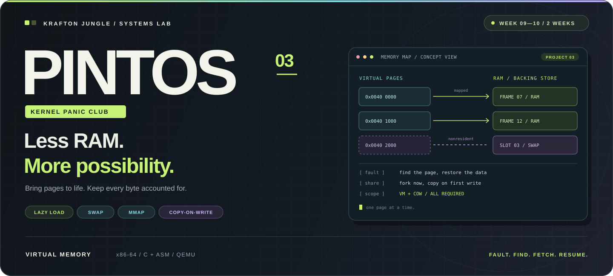
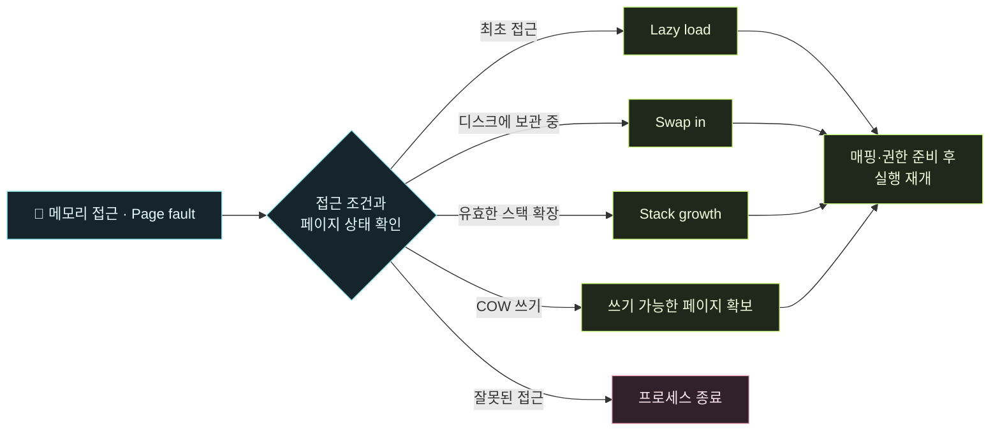

<p align="center">
  
</p>

<div align="center">

### 🌌 RAM은 유한하게. 가능성은 그 너머로.

**KRAFTON JUNGLE · WEEK 09—10 · PROJECT 03**

필요할 때 불러오고, 부족하면 비워내고, 쓸 때 비로소 복사합니다.<br />
**주소 하나의 여정을 끝까지 책임지는, 2주간의 가상 메모리 프로젝트.**

<kbd>PROJECT 03 · VIRTUAL MEMORY</kbd> &nbsp;
<kbd>x86-64</kbd> &nbsp;
<kbd>2 WEEKS</kbd> &nbsp;
<kbd>COW REQUIRED</kbd>

**[🚀 시작하기](#quick-start)** &nbsp; / &nbsp;
**[🧠 이번 미션](#mission)** &nbsp; / &nbsp;
**[🧪 테스트](#testing)** &nbsp; / &nbsp;
**[🗺️ 코드 지도](#code-map)** &nbsp; / &nbsp;
**[📚 명세](#references)**

[Issues](https://github.com/9192o/week-9-10-vm-pintos/issues) &nbsp;·&nbsp;
[Pull Requests](https://github.com/9192o/week-9-10-vm-pintos/pulls) &nbsp;·&nbsp;
[KAIST Pintos](https://casys-kaist.github.io/pintos-kaist/)

</div>

<br />

> **💥 KERNEL PANIC CLUB / SEASON 03**
>
> 어제는 사용자 프로그램을 실행했습니다. 이번에는 그 프로그램이 믿는 메모리를 만듭니다.<br />
> **Page fault를 만나도, 모든 이야기가 끝나는 것은 아닙니다.**

<br />

<a id="mission"></a>
## 🧠 LESS RAM. MORE POSSIBILITY.

**Project 3 · Virtual Memory** — 프로그램의 가상 주소 공간과 실제 RAM의 사용을 분리합니다.<br />
필요한 페이지를 준비하고, 프레임을 재사용하고, 프로세스가 끝나면 남은 자원까지 회수합니다.

<table>
  <tr>
    <td width="33%" valign="top">
      <h3>🪄 01 / LOAD ON DEMAND</h3>
      <strong>SPT · Lazy Loading · Stack Growth</strong>
      <p>아직 RAM에 없는 정상 페이지를 찾아냅니다. 접근하는 순간 내용을 준비하고, 필요한 만큼 사용자 스택을 확장합니다.</p>
      <sub>Know the page. Bring it to life.</sub>
    </td>
    <td width="33%" valign="top">
      <h3>♻️ 02 / MAKE ROOM</h3>
      <strong>Frames · Eviction · Swap</strong>
      <p>RAM이 부족하면 프레임을 확보합니다. 페이지의 내용을 보존하고, 다시 필요해지면 원래대로 복원합니다.</p>
      <sub>Finite frames. Carefully managed.</sub>
    </td>
    <td width="33%" valign="top">
      <h3>🧬 03 / SHARE UNTIL WRITE</h3>
      <strong>mmap · Lifecycle · COW</strong>
      <p>파일과 메모리를 연결하고, 복제와 종료의 자원 수명을 관리합니다. fork의 실제 복사는 쓰기 시점까지 미룹니다.</p>
      <sub>Share safely. Copy when needed.</sub>
    </td>
  </tr>
</table>

### 🎯 THE MISSION CONTRACT

| 범위 | 우리가 구현할 동작 |
| :--- | :--- |
| **🗂️ Supplemental Page Table** | 프로세스별 페이지 정보 등록·검색·복제·정리 |
| **⚡ Lazy Loading** | 실행 파일의 페이지를 실제 접근 시점에 준비 |
| **📐 Stack Growth** | 유효한 스택 접근을 판단해 확장 · 공식 상한 **1MiB** |
| **🧱 Frame Management** | 물리 프레임 추적 · 피해 프레임 선택 · 퇴거 |
| **💽 Swap In / Out** | anonymous 페이지 보존·복원 · swap 슬롯 회수 |
| **📎 Memory-Mapped Files** | `mmap` / `munmap` · lazy load · 변경된 내용만 파일에 반영 |
| **🔗 Process Integration** | `fork` / `exec` / `exit`에 페이지 복제·교체·정리 연결 |
| **🧬 Copy-on-Write** | fork 시 프레임 공유 · 쓰기 시 분리 · 공유 자원 수명 관리 |

> **학교 과제 기준: extra를 포함한 Project 3 전체가 필수입니다.**<br />
> 공식 매뉴얼의 **Copy-on-Write (Extra)**도 이번 2주 목표에 포함합니다.<br />
> 위 목록은 구현 범위이며, 완료·테스트 통과를 표시한 목록은 아닙니다.

<br />

## ⚡ A PAGE FAULT IS A QUESTION.

“잘못된 주소인가? 아직 준비하지 않았을 뿐인가?”<br />
커널은 접근 권한과 페이지 상태를 확인하고 다음 동작을 결정합니다.



**SPT는 페이지의 사정을 기록하고, `pml4`는 CPU가 사용할 매핑과 권한을 담습니다.**<br />
둘을 함께 관리해야 “지금 RAM에 없음”과 “접근하면 안 됨”을 구분할 수 있습니다.

<br />

## 🛣️ FROM THREADS TO VIRTUAL MEMORY

| Chapter | 다루는 것 | 이번 저장소에서의 위치 |
| :--- | :--- | :--- |
| **01 · Threads** | Alarm Clock · Priority · Synchronization · MLFQS | 🧱 스케줄링·동기화 기반 |
| **02 · User Programs** | Arguments · System Calls · Process Lifecycle · File I/O | 🔗 VM과 연결할 프로세스 기반 |
| **03 · Virtual Memory** | SPT · Lazy Loading · Stack · Swap · mmap · COW | 🔥 **9~10주차 미션** |
| **04 · File System** | 파일 시스템 확장 · 디렉터리 · 경로 | 🔭 다음 챕터 |

<br />

<a id="quick-start"></a>
## 🚀 BOOT THE WORKSPACE

### 01 / 저장소 가져오기

호스트 터미널에서 실행합니다.

```bash
git clone https://github.com/9192o/week-9-10-vm-pintos.git
cd week-9-10-vm-pintos
```

이미 로컬 저장소가 있다면 해당 폴더를 그대로 사용합니다. 폴더 이름은 달라도 됩니다.

### 02 / 컨테이너 열기

1. [Docker Desktop](https://www.docker.com/products/docker-desktop/)을 실행합니다.
2. VS Code에 [Dev Containers](https://marketplace.visualstudio.com/items?itemName=ms-vscode-remote.remote-containers)를 설치합니다.
3. 저장소 폴더를 열고 **Dev Containers: Reopen in Container**를 선택합니다.

개발 환경은 **Ubuntu 22.04 · x86-64 · GCC · Make · GDB · QEMU**입니다.<br />
설정은 [Dockerfile](.devcontainer/Dockerfile)과 [devcontainer.json](.devcontainer/devcontainer.json)에서 확인합니다.

### 03 / VM 빌드

컨테이너 안의 **Bash 터미널**에서 실행합니다. 저장소 내부 어느 경로에서든 시작할 수 있습니다.

```bash
export PINTOS_ROOT="$(git rev-parse --show-toplevel)"
export PATH="$PINTOS_ROOT/pintos/utils:$PATH"

cd "$PINTOS_ROOT/pintos/vm"
make
```

| 이번에 빌드할 대상 | 디렉터리 | 설정 |
| :--- | :--- | :--- |
| **Project 3 — VM** | `pintos/vm` | `USERPROG` + `FILESYS` + `VM` |
| Project 2 단독 확인 | `pintos/userprog` | 기존 사용자 프로그램 환경 |
| Project 1 단독 확인 | `pintos/threads` | 스레드·스케줄러 환경 |

<details>
<summary><strong>🩹 환경이 말썽일 때 — PATH · CRLF · 이전 저장소 경로</strong></summary>

**`pintos: command not found` / 테스트 실행 `Error 127`**

위의 `PINTOS_ROOT`와 `PATH` 설정을 현재 터미널에서도 실행했는지 확인합니다. 실제 원인은 각 테스트의 `.errors` 파일에서 확인합니다.

**`python3\r`, `bash\r`, `syntax error near fi`**

실행 스크립트가 CRLF로 저장된 경우입니다. 해당 오류가 발생하면 다음 파일의 줄바꿈을 LF로 정리합니다.

```bash
sed -i 's/\r$//' "$PINTOS_ROOT/pintos/activate" \
  "$PINTOS_ROOT/pintos/utils/pintos" \
  "$PINTOS_ROOT/pintos/utils/pintos-mkdisk" \
  "$PINTOS_ROOT/pintos/utils/backtrace"
```

**터미널 시작 시 `/workspaces/pintos_22.04_lab_docker` 경로 오류**

현재 Dockerfile의 Bash 시작 설정에는 이전 경로가 남아 있습니다. 위 Quick Start는 현재 Git 저장소의 실제 위치로 PATH를 설정합니다.

</details>

<br />

<a id="testing"></a>
## 🧪 MAKE IT WORK. PROVE IT.

### 전체 확인

Quick Start의 환경 설정 후, **VM 디렉터리**에서 실행합니다.

```bash
cd "$PINTOS_ROOT/pintos/vm"
make check
```

현재 [VM 테스트 설정](pintos/vm/Make.vars)은 사용자 프로그램·VM·파일 시스템 기본·스레드와 **COW**를 포함합니다. 통과 상태는 실제 실행 결과로 확인합니다.

### 하나씩 좁혀가기

VM 빌드가 끝난 뒤 `pintos/vm/build`에서 실행합니다. 아래는 테스트 선택 예시이며, 고정된 통과 순서는 아닙니다.

```bash
cd "$PINTOS_ROOT/pintos/vm/build"

# 기존 실행 경로 / 최초 페이지 접근
make tests/userprog/args-none.result
make tests/vm/lazy-anon.result

# 스택 / 파일 매핑 / 메모리 압박
make tests/vm/pt-grow-stack.result
make tests/vm/mmap-read.result
make tests/vm/swap-anon.result

# 이번 과제에서는 COW도 필수
make tests/vm/cow/cow-simple.result
```

| 읽을 파일 | 찾을 단서 |
| :--- | :--- |
| `build/results` | 전체 테스트의 PASS / FAIL 요약 |
| `build/tests/**/*.result` | 개별 테스트 판정과 차이 |
| `build/tests/**/*.output` | 커널·사용자 출력, panic, 진행이 멈춘 위치 |
| `build/tests/**/*.errors` | 실행기 오류와 진단 출력 |

> 🔬 **PASS는 실행한 범위만 증명합니다.**<br />
> 수정 후 결과가 최신인지 확인하고, 실패하면 전체 병렬 실행보다 개별 로그부터 좁힙니다.<br />
> 메모리 압박 테스트는 작은 RAM 설정 자체가 검증 조건입니다.

<br />

<a id="code-map"></a>
## 🗺️ FOLLOW THE ADDRESS

```text
week-9-10-vm-pintos/
├── .devcontainer/          # Ubuntu 22.04 개발 환경
├── assets/                 # README 비주얼
├── pintos/
│   ├── vm/                 # SPT · frame · lazy init · anon · file
│   ├── userprog/           # loader · syscall · fault · process lifecycle
│   ├── threads/            # scheduling · synchronization · pml4
│   ├── devices/            # timer · console · disk
│   ├── filesys/            # 파일 접근과 저장
│   ├── include/vm/         # page · frame · 페이지 종류별 선언
│   └── tests/vm/           # VM 테스트 · cow/ 포함
└── README.md
```

| 확인할 질문 | 처음 펼칠 파일 |
| :--- | :--- |
| **이 가상 페이지는 어떤 페이지인가?** | [vm.h](pintos/include/vm/vm.h) · [vm.c](pintos/vm/vm.c) |
| **처음 접근했을 때 무엇을 불러오는가?** | [uninit.c](pintos/vm/uninit.c) · [process.c](pintos/userprog/process.c) |
| **RAM에서 내보낸 내용은 어디에 있는가?** | [anon.c](pintos/vm/anon.c) · [file.c](pintos/vm/file.c) |
| **이 fault는 복구할 수 있는가?** | [exception.c](pintos/userprog/exception.c) · [vm.c](pintos/vm/vm.c) |
| **CPU에 보이는 매핑과 권한은 무엇인가?** | [mmu.c](pintos/threads/mmu.c) · [pte.h](pintos/include/threads/pte.h) |
| **새 syscall과 기존 프로세스는 어디서 만나는가?** | [syscall.c](pintos/userprog/syscall.c) · [process.c](pintos/userprog/process.c) |

<br />

## 🤝 OWN THE PAGE. SHARE THE CONTEXT.

**같은 함수를 셋이 고치기 전에, 같은 페이지를 셋이 설명할 수 있게.**

| 함께 맞출 것 | 합의할 질문 |
| :--- | :--- |
| **페이지·프레임의 소유권** | 누가 연결하고, 누가 해제하며, 공유 중이면 언제 회수하는가? |
| **Lazy 정보와 파일 참조** | 최초 접근 전·후, fork·exec·exit에서 누가 보관하고 정리하는가? |
| **Swap 슬롯과 파일 반영** | 어디에 보존하며, 언제 복원·반영·반환하는가? |
| **락과 통합 경로** | fault 처리와 파일 I/O가 만나도 서로를 기다리며 멈추지 않는가? |

- 구현 담당이 나뉘어도 **page fault부터 자원 정리까지**의 흐름은 함께 이해합니다.
- 작업 브랜치는 `feature/...`, 통합 대상은 PR을 열기 전에 팀과 확인합니다.
- PR에는 **목적 · 흐름과 소유권 · 실행한 테스트 · 남은 작업**을 남깁니다.
- 공통 구조체를 바꾸면 복제·실패·해제 경로까지 함께 확인합니다.
- 제공 템플릿의 **`DO NOT CHANGE`** 부분과 검사 도구는 유지합니다.

<br />

<a id="references"></a>
## 📚 UNDERSTANDING IS A DELIVERABLE.

```text
작은 목표 → 내 예상 → 실행·소스 확인 → 내 말로 설명 → 조건 하나 바꾸기 → 자료 없이 복원
```

구현은 직접 합니다. AI는 개념 연결, 힌트, 코드 읽기, 리뷰와 검증에 활용합니다.<br />
**테스트가 통과한 이유와, 조건이 바뀌면 깨지는 지점을 함께 설명합니다.**

| Reference | 바로가기 |
| :--- | :--- |
| **과제의 전체 그림** | [Project 3 Introduction](https://casys-kaist.github.io/pintos-kaist/project3/introduction.html) |
| **페이지·프레임·SPT** | [Memory Management](https://casys-kaist.github.io/pintos-kaist/project3/vm_management.html) |
| **지연 로딩과 anonymous 페이지** | [Anonymous Page](https://casys-kaist.github.io/pintos-kaist/project3/anon.html) |
| **사용자 스택 확장** | [Stack Growth](https://casys-kaist.github.io/pintos-kaist/project3/stack_growth.html) |
| **파일 매핑과 write-back** | [Memory Mapped Files](https://casys-kaist.github.io/pintos-kaist/project3/memory_mapped_files.html) |
| **메모리 압박과 복원** | [Swap In / Out](https://casys-kaist.github.io/pintos-kaist/project3/swapping.html) |
| **필수 COW** | [Copy-on-Write](https://casys-kaist.github.io/pintos-kaist/project3/cow.html) |
| **정글 제공 자료** | [공유 강의 자료](https://drive.google.com/file/d/10XIARiFLUCalZju5qO1CJzyx8biEJkZS/view?usp=sharing) |
| **Upstream** | [KAIST Pintos](https://github.com/casys-kaist/pintos-kaist) · [Jungle Docker](https://github.com/krafton-jungle/pintos_22.04_lab_docker) |
| **License** | [pintos/LICENSE](pintos/LICENSE) |

<br />

---

<div align="center">

**🌴 BUILT IN THE JUNGLE. MAPPED WITH INTENT.**

<sub>Fault. Find. Fetch. Resume.</sub><br />
<sub>한 페이지씩, 끝까지 이해하는 운영체제.</sub>

</div>
